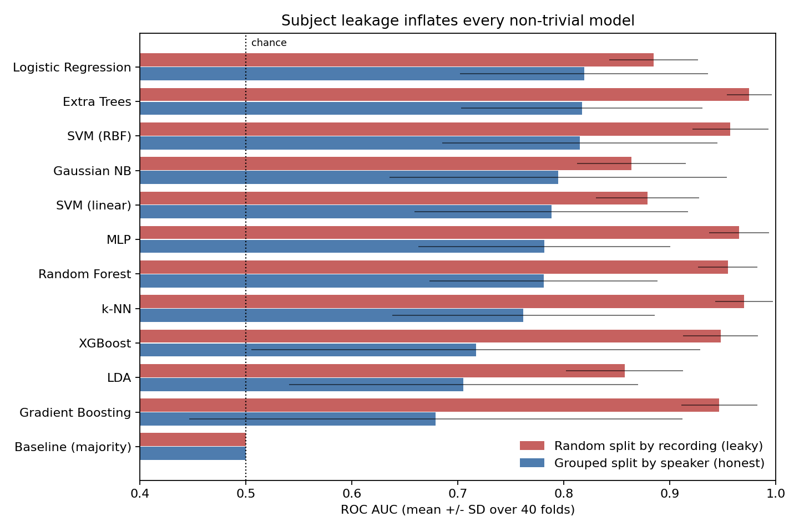
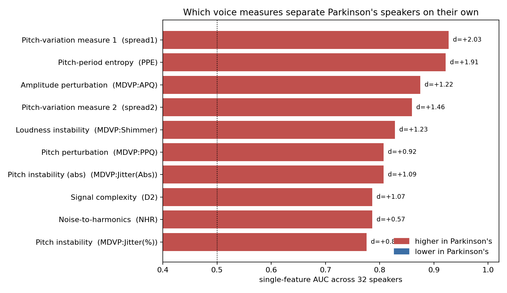
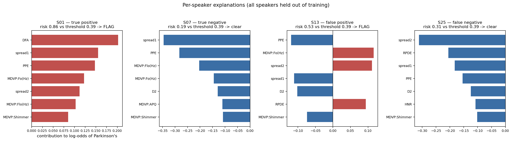
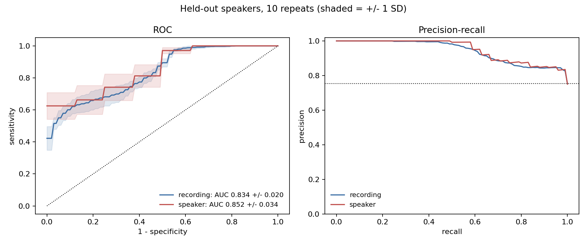

# Parkinson's Disease Detection from Voice, with Explainable AI

**Project site:** https://parkinsons-voice-xai.vercel.app (an interactive walkthrough of the study and its results)

Parkinson's disease affects the muscles that control speech. This project uses 195
voice recordings to predict whether a speaker has Parkinson's, and then explains
exactly which parts of the voice led to each prediction.

The interesting part is not the model. It is what the explanations revealed. One
single voice measurement predicts better than all sixteen together. And the accuracy
figures normally reported for this dataset turn out to be inflated, because of a flaw
in how the data is split.

**[Read the full notebook with all results and charts](notebooks/parkinsons_xai.ipynb)**

## Results

Tested on people the model had never heard before.

| What it measures | Score |
|---|---|
| ROC-AUC (overall ranking quality, 1.0 is perfect, 0.5 is guessing) | **0.852** |
| Sensitivity (share of Parkinson's cases caught) | **92%** |
| Specificity (share of healthy people correctly cleared) | **49%** |
| Best single-feature model | **0.924** ROC-AUC |

In plain terms: the test almost never misses someone who has Parkinson's, but it
raises a false alarm on about half of healthy people. That makes it useful as an early
warning step before a doctor's assessment, not as a diagnosis on its own.

Every number in this README came from running the code in `src/`. Nothing is copied
from a paper or estimated by hand.

## What is new here

**1. I found and fixed a flaw that inflates most published results on this dataset.**

The 195 recordings come from only 32 people. Each person recorded their voice 6 or 7
times in one sitting. Almost every project on this dataset splits the recordings
randomly, which puts five of a person's recordings in training and the sixth in
testing. The model can then score well simply by recognising a familiar voice rather
than by detecting the disease.

I split by person instead, so no voice appears on both sides. I measured what this
is worth across 12 models and 960 test runs:

| | Random split (what most projects do) | Split by person (correct) |
|---|---|---|
| Best score | 0.975 | 0.819 |
| Average inflation | | **+0.159 ROC-AUC** |
| Models affected | | **11 of 11**, all statistically significant |
| Do the two methods agree on which model is best? | | **No.** Rank correlation 0.19 |

That last row is the real cost. Under the flawed split, Extra Trees looks like the
best model. Under the correct split, Logistic Regression wins. Picking a model using
the flawed method is close to picking at random.



**2. Explainability changed the model, instead of just describing it.**

I expected SHAP to produce a nice chart. Instead it showed that one measurement,
`spread1`, ranks first, with `PPE` close behind. So I tested it directly.

| Model | Features used | Score |
|---|---|---|
| `spread1` only | 1 | **0.924** |
| `PPE` only | 1 | 0.920 |
| All features | 16 | 0.847 |

The one-feature model is more accurate and eight times more consistent between runs.
With only 32 people in the dataset, the extra fifteen features are fitting noise. That
points towards a small test built on one or two pitch measurements, which this project
did not build or test, rather than a large ensemble.

**3. Simpler models won.**

I benchmarked 12 algorithms including Random Forest, XGBoost, SVM and a neural
network. Logistic Regression beat all of them once the data was split correctly. With
32 people there is not enough data for complex models to find anything a straight line
misses, and they become unstable trying.

## What the voice actually tells us

Parkinson's makes it hard to hold a steady pitch, because it disrupts fine control of
the muscles in the voice box. The data shows exactly that.

| Voice measurement | What it means | In Parkinson's | Effect size | Score alone |
|---|---|---|---|---|
| `spread1` | How erratically pitch moves | Higher | 2.03 | 0.927 |
| `PPE` | Irregularity in pitch control | Higher | 1.91 | 0.922 |
| `MDVP:APQ` | Instability in loudness | Higher | 1.22 | 0.875 |
| `spread2` | How erratically pitch moves | Higher | 1.46 | 0.859 |
| `MDVP:Shimmer` | Variation in volume between cycles | Higher | 1.24 | 0.828 |

An effect size above 0.8 is considered large. The top two are above 1.9, which is very
large. Notably, the classic voice measures used in most Parkinson's papers (jitter and
shimmer) rank below the pitch-stability measures.



## Explaining individual people

A screening tool has to answer one question for the person using it: why was I
flagged? Each card below shows one person and the specific voice measurements that
pushed their score up or down. All four were held out of training.



The fourth card is the most honest one. That person has Parkinson's but scored 0.31,
below the alarm threshold, so the model missed them. Their pitch measurements sit in
the healthy range. A voice test cannot detect someone whose voice is not yet affected.
That is a limit of using voice at all, not a bug in the model.

## Setting the alarm level

A screening test is defined by where you set the threshold, not by its accuracy. I
tuned it to catch 90% of cases and then measured what that costs.

| | Per recording | Per person |
|---|---|---|
| ROC-AUC | 0.834 (SD 0.021) | **0.852** (SD 0.036) |
| Sensitivity | 89.7% | **92.1%** |
| Specificity | 48.3% | **48.8%** |

In one full round, each of the 32 people (8 healthy, 24 with Parkinson's) is tested
once by a model that never saw them. On average the model clears about 4 healthy people
and falsely alarms on about 4. It catches about 22 cases and misses about 2.



## Running it

```bash
pip install -r requirements.txt

cd src
python run_experiments.py          # benchmark all 12 models, about 6 minutes
python run_experiments.py --combine
python analysis.py                 # leakage measurement and charts
python screening.py                # threshold, ROC curves, calibration
python biomarkers.py               # voice measures and per-person cards
python explain.py                  # SHAP, feature importance, LIME
python explain.py --stability      # how stable the explanations are

cd ../notebooks
python build_notebook.py
jupyter nbconvert --to notebook --execute --inplace parkinsons_xai.ipynb
```

The benchmark saves one file per model, so an interrupted run picks up where it
stopped. Run a single model with:

```bash
python run_experiments.py --protocol subject --models "Logistic Regression"
```

## How it is built

* **Testing method.** Every model is tested 40 times (4 splits, repeated 10 times).
  Settings are tuned inside each split, never on the test data.
* **No voice crosses the split.** All splits group by person.
* **The alarm threshold is also protected.** It is chosen using only training data,
  then frozen before testing. Tuning a threshold on your test set is a quiet way to
  cheat.
* **Scaling happens inside the pipeline**, refitted per split, so test data never
  influences training.
* **Duplicate features removed.** Six columns were mathematically identical to others
  (`Jitter:DDP` is exactly 3 times `MDVP:RAP`). Keeping both splits their importance
  and corrupts the explanations. 22 features became 16.
* **Explanations use unseen people only.** Explaining training data describes
  memorisation, not real behaviour.
* **Accuracy is deliberately not the headline.** 75.4% of recordings are Parkinson's,
  so a model that always says "Parkinson's" is already 75.4% accurate.

## A note on a common SHAP mistake

For a two-class problem, SHAP returns values for both classes, and the two are mirror
images of each other. Averaging across them cancels them out. Measured on this data,
the averaged version gives **0.0000000000000000135** and the correct version gives
**0.0316**. Any chart built on the average is showing rounding noise. This is a common
error in notebooks on this dataset, so it is documented in the code.

I also checked whether the explanations themselves are trustworthy by recomputing them
across 12 different splits. Only `spread1` and `PPE` rank consistently. Everything
below them shuffles around. That is why the conclusion points to one or two measurements,
not a top-ten list of biomarkers.

## What this cannot do

* **32 people is a small sample.** Only 8 are healthy, so the specificity number rests
  on 8 people. Treat all figures as approximate.
* **One recording session, one setup.** Nothing here shows it would work on a
  different microphone, a different language, or a different clinic.
* **No separate hold-out set.** All results are cross-validation estimates. The
  dataset is too small to split off a meaningful final test set.
* **It does not show early detection.** Everyone in the data already has a diagnosis.
* **This is not a medical device.** It is a research and methodology project on a
  public dataset.

## Project structure

```
├── data/parkinsons.data          UCI dataset, 195 recordings from 32 people
├── src/
│   ├── config.py                 paths, seeds, settings
│   ├── data.py                   loading, person IDs, duplicate removal
│   ├── models.py                 12 models and their tuning grids
│   ├── evaluation.py             both splitting methods, testing loop
│   ├── run_experiments.py        benchmark runner
│   ├── screening.py              threshold, ROC curves, calibration
│   ├── biomarkers.py             voice measures, per-person cards
│   ├── analysis.py               leakage measurement and charts
│   └── explain.py                SHAP, feature importance, LIME
├── notebooks/
│   ├── parkinsons_xai.ipynb      full write-up with every result
│   └── build_notebook.py         regenerates the notebook from source
└── results/
    ├── figures/                  18 charts
    ├── tables/                   all test results
    └── *.json                    summary reports
```

**Built with:** Python, scikit-learn, XGBoost, SHAP, LIME, pandas, matplotlib.

## Data

The dataset is the Oxford Parkinson's Disease Detection Dataset. It is widely mirrored
on Kaggle, but the source of record is the UCI Machine Learning Repository, so that is
what is cited here.

**Source:** [UCI Machine Learning Repository, "Parkinsons" (ID 174)](https://archive.ics.uci.edu/dataset/174/parkinsons)
**Creator:** Max Little, University of Oxford, with the National Centre for Voice and
Speech, Denver, Colorado
**Licence:** Creative Commons Attribution 4.0 International (CC BY 4.0), verified
against the UCI dataset page

```
Little, M. (2007). Parkinsons [Dataset]. UCI Machine Learning Repository.
https://doi.org/10.24432/C59C74

Little, M., McSharry, P., Roberts, S., Costello, D., & Moroz, I. (2007). Exploiting
nonlinear recurrence and fractal scaling properties for voice disorder detection.
BioMedical Engineering OnLine, 6:23. https://doi.org/10.1186/1475-925X-6-23
```

### A note on the number of people

UCI documents this dataset as 195 recordings from **31 people**, 23 of them with
Parkinson's. The `name` column actually contains **32 distinct subject IDs**, splitting
24 to 8. I group by subject ID, because that is the only grouping the file supports.

If two of those IDs really are the same person, then that person could appear on both
sides of a split, and the reported scores would be very slightly optimistic. The effect
is small, and it runs in the safe direction for the main argument of this project:
grouping by ID is strictly more conservative than not grouping at all.

## Author

**Tanishk Jain**
[GitHub](https://github.com/tanishhhk) | [LinkedIn](https://linkedin.com/in/tanishhhk)

## License

Two licences apply.

The **code** in `src/`, `notebooks/` and the generated `results/` is released under the
MIT License.

The **dataset** in `data/parkinsons.data` is not mine to license. It is redistributed
under CC BY 4.0 with the attribution given above. CC BY 4.0 allows redistribution and
adaptation, including commercially, as long as credit is given. See `LICENSE` for the
full text of both.
